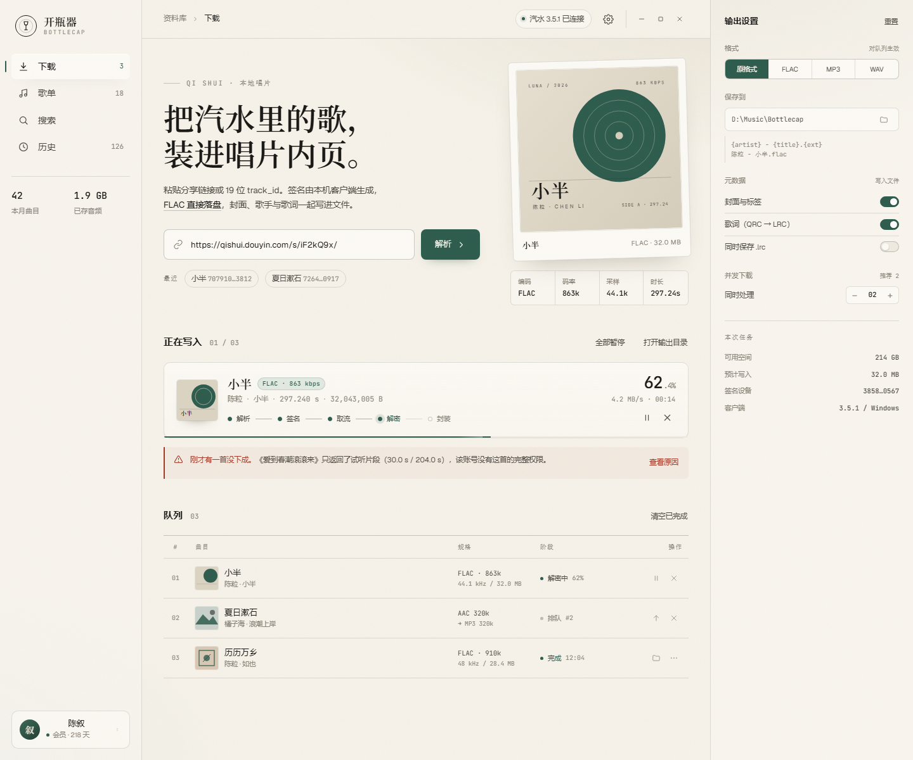

# 开瓶器 Bottlecap

汽水音乐整曲下载器 · 浅色纸感桌面应用

> 仅用于个人学习、技术研究，以及下载自己有权播放的内容。本项目不提供音源、账号或会员，不鼓励传播下载内容。



## 功能

- **登录**：应用内扫码（passport 二维码）或读取本机已登录客户端；凭据只留在主进程
- **解析**：19 位 `track_id`、分享短链、分享文案
- **下载**：`bdms.node` 客户端签名 → `track_v2` → spade/AES-CTR 解密 → 重组 FLAC
- **歌单**：账号全部歌单、歌单详情、整单/勾选批量下载
- **搜索**：关键词搜索，结果可直接试听或入队
- **队列**：并发 1–4、暂停/继续/取消/重试、历史记录
- **试听**：解密后本地流式播放，可拖动进度、调音量；不写入输出目录
- **格式**：原格式 / FLAC / MP3 / WAV；仅 AAC 曲目输出可播放 `.m4a`
- **元数据**：标题、歌手、专辑、1000×1000 封面、歌词；可选同名 `.lrc`

## 下载安装

前往 [Releases](https://github.com/REALIKUN2024/bottlecap/releases/latest) 下载：

- `Bottlecap-0.2.0-Setup.exe`（Windows 10/11 x64，内置 ffmpeg/ffprobe，约 182MB）

安装包未签名，首次运行可能出现「未知发布者」提示。

### 运行要求

- Windows 10/11 x64
- 已安装并登录 **汽水音乐 3.5.1 客户端**（签名模块来自客户端）
- 账号对目标曲目有完整播放权限；仅返回试听片段时应用会明确提示

## 使用

1. 打开并登录汽水音乐客户端（或准备用手机扫码）
2. 启动开瓶器，扫码或点「使用本机客户端」连接
3. 粘贴分享链接/ID，或在歌单、搜索里挑歌
4. 点「试听」预览，点「加入下载」入队
5. 在右侧面板或设置里选择输出格式与目录

> 首次运行会在 `%APPDATA%\bottlecap` 保存设置与加密后的登录态。

## 试听

- 主进程下载并解密到系统临时目录，通过自定义协议 `bottlecap-preview://` 以 Range 流式播放
- FLAC 直接播放；AAC 用 ffmpeg 快速封装为 `.m4a`
- 关闭试听立即清理，未关闭的 30 分钟后清理
- 不进入下载历史，不写入输出目录

## 技术实现

```text
Renderer (React 19, contextIsolation)
  │ typed IPC / preload
Main (Electron 45)
  ├─ qishui/  Cookies · DeviceV1 · bdms 签名 · track_v2 · 歌单 · 搜索
  ├─ media/   spade → AES-CTR → FLAC 重组 / AAC → ADTS · ffmpeg 转码与标签
  ├─ preview/ 临时解密文件 + bottlecap-preview:// Range 流
  ├─ queue/   并发调度 · 进度 · 失败重试
  └─ store/   设置 · 历史 · safeStorage 登录态
```

- `bdms.node` 在 Electron 主进程内加载（已实测），无需外置 Node
- sessionid 只存在主进程内存 / `safeStorage` 加密文件，不进入渲染层
- 下载先写临时文件，成功后原子重命名；失败清理
- 音频标签与转码统一交给 ffmpeg

## 开发

```bash
pnpm install
pnpm dev          # Electron + Vite
pnpm typecheck
pnpm build
```

## 打包

```bash
pnpm run pack     # release/win-unpacked
pnpm run dist     # release/Bottlecap-<version>-Setup.exe
```

`scripts/prepare-runtime.mjs` 会把系统 ffmpeg/ffprobe 复制到 `resources/bin`，随安装包内置。
没有内置时运行时会回退到系统 PATH。

## 文档

- [设计规范](docs/DESIGN.md)
- [实施计划](docs/PLAN.md)
- [接口笔记](docs/api-notes.md)
- [静态视觉稿](docs/mockup.html)

## 已知限制

- 队列未做跨重启恢复（历史与设置会持久化）
- 签名、UA、version_code 与客户端版本绑定，客户端升级后可能需要适配
- 视频 / MV 下载未实现
- 安装包未签名，也没有自动更新
- 二维码获取已验证；真实手机扫码确认需要人工完成

## 免责声明

本项目仅用于技术研究与个人备份。使用者应自行确认对下载内容拥有合法权限，并遵守汽水音乐/抖音的服务条款及当地法律。
作者不对账号封禁、数据丢失、版权纠纷或任何其他后果负责。公开仓库与 Release 不代表授权传播受版权保护的内容。

## 许可证

本仓库未授予开源许可证，保留所有权利。

安装包内置的 ffmpeg/ffprobe 来自 [gyan.dev](https://www.gyan.dev/ffmpeg/builds/) 的 essentials build，
遵循其 GPL 许可证；许可证全文见 [resources/FFMPEG-LICENSE.txt](resources/FFMPEG-LICENSE.txt)。
